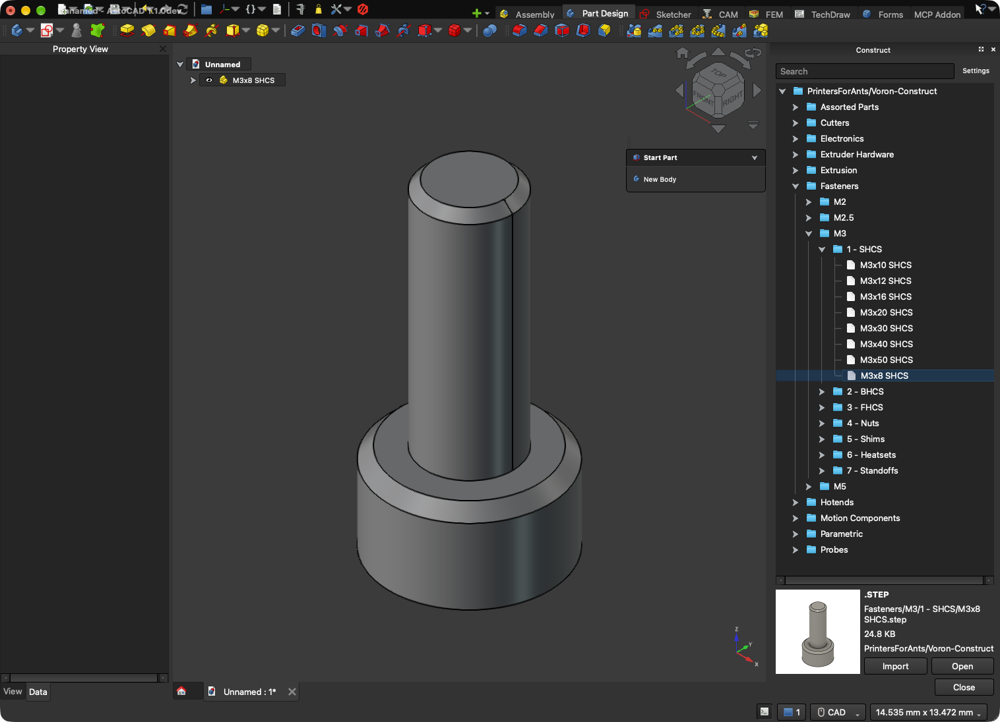

# Voron Construct Browser

A FreeCAD / AstoCAD addon for browsing the Voron Construct parts library and
adding its STEP parts to your document. Pick a part in the panel and import it
as a component, or open it in a new document. You can point it at a fork of the
library to use your own parts.



## Requirements

- AstoCAD or FreeCAD 1.1. The addon is developed and tested with AstoCAD on
  macOS. The GitHub client also runs on the Python bundled with FreeCAD 1.1,
  but the panel has not been tried in plain FreeCAD.
- Python 3.11 or later, PySide6, and `requests`. All three ship with AstoCAD
  and FreeCAD, so there is nothing to install.
- Internet access to `api.github.com` and `raw.githubusercontent.com`.
  GitHub allows 60 anonymous API requests per hour. A GitHub token in the
  settings raises the limit and is otherwise optional.

## Install

### 1. Find the Mod folder

In AstoCAD or FreeCAD, open **View > Panels > Python console** and run:

```python
import os

print(os.path.join(FreeCAD.getUserAppDataDir(), "Mod"))
```

On macOS the folders are:

| Application | Mod folder |
| --- | --- |
| AstoCAD 1.1 | `~/Library/Application Support/AstoCAD/v1-1/Mod/` |
| FreeCAD 1.1 | `~/Library/Application Support/FreeCAD/v1-1/Mod/` |

### 2. Add the addon

Download `Voron-Construct-FreeCAD-<version>.zip` from the
[Releases page](https://github.com/mjonuschat/Voron-Construct-FreeCAD/releases)
and unzip it into the Mod folder. This creates `Voron-Construct-FreeCAD` there.

Or install from source. Clone the repository and copy its `Construct` folder
into the Mod folder under the name `Voron-Construct-FreeCAD`. For AstoCAD on
macOS:

```bash
git clone https://github.com/mjonuschat/Voron-Construct-FreeCAD.git
cd Voron-Construct-FreeCAD
cp -r Construct ~/Library/Application\ Support/AstoCAD/v1-1/Mod/Voron-Construct-FreeCAD
```

### 3. Restart

Check that `Mod/Voron-Construct-FreeCAD/InitGui.py` exists, with no extra
folder level in between, then restart the application. Keep only one copy of
the addon in the Mod folder.

If the toolbar button is missing, open **View > Panels > Report view** and
look for import errors from `Construct`.

## Usage

Open the panel with the toolbar button on the File toolbar, or with the
entry in the Tools menu. The tooltip reads "Load the Construct / I Need
CAD...Lots of CAD".

- The search field filters the tree. Folder names are searched too, unless
  you turn that off in the settings.
- Selecting a part shows its thumbnail, file type, path, size, and repository
  at the bottom of the panel.
- Import adds the part to the active document as an `App::Part` named after
  the file. If no document is open, one is created.
- Open loads the STEP file into a new document.
- Thumbnails beside parts in the tree are off by default. Turn them on in the
  settings.

## Settings

The settings button next to the search field opens the dialog.

| Setting | Default |
|---|---|
| Repository (`owner/repo`) | `PrintersForAnts/Voron-Construct` |
| Branch | empty (the repository's default branch) |
| GitHub access token | empty (optional, raises the API rate limit) |
| Font size | system |
| Show thumbnails | off |
| Search folder names | on |
| Hide unsupported parts | off |

To use a fork, set Repository to `owner/repo` of the fork, for example
`mjonuschat/Voron-Construct`, and set Branch if you want something other
than its default branch. Changing either one discards the loaded tree and
reloads it. Different repositories and branches use separate cache folders.

The addon saves its settings in the FreeCAD parameter group
`User parameter:BaseApp/Preferences/Mod/Construct`, and the token is saved
there in plain text.

## Converter

Many parts in the upstream repository exist only as Fusion 360 files, which
FreeCAD cannot read. `tools/fusion_export/` contains a Fusion script that
writes a `.step` file next to each of them. See
[tools/fusion_export/README.md](tools/fusion_export/README.md). The addon
works with any repository that has STEP files, not only a converted fork.

## Limits

- Parametric generators export as one fixed size, the one saved in the Fusion
  file.
- Parts that have only a Fusion file are greyed out until a STEP file exists.
  The Hide unsupported parts setting hides them.

## Development

To work on the addon, link the folder instead of copying it, so edits apply
after a restart:

```bash
ln -s "$PWD/Construct" ~/Library/Application\ Support/AstoCAD/v1-1/Mod/Voron-Construct-FreeCAD
```

To run the tests:

```bash
python3 -m venv .venv && .venv/bin/pip install pytest requests PySide6 ruff
.venv/bin/pytest
scripts/run_freecad_tests.sh
```

The pytest suite runs outside FreeCAD. `scripts/run_freecad_tests.sh` runs
the tests that need the FreeCAD Python environment.

## Credits

The toolbar icon is the Voron hex logo from VoronDesign/Voron-Extras
(Images/Logo/SVG/Hex_Logo.svg, GPL-3.0). The parts library is
PrintersForAnts/Voron-Construct.

`tests/data/m5_shim_washer.step` is the M5 Shim Washer from
PrintersForAnts/Voron-Construct, used as a test file. That repository is
MIT-licensed; its license text is in `tests/data/LICENSE-Voron-Construct`.

## License

This project is licensed under the GNU General Public License, version 3.
See [LICENSE](LICENSE).
